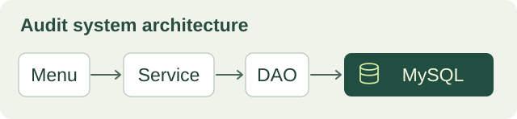
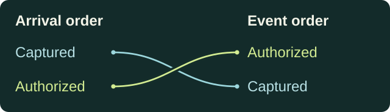

I build backend services with **Java, Spring Boot, and MySQL**. I’m a Computer Science and Engineering student at Symbiosis Institute of Technology, Pune (class of 2028), looking for a software development internship. [Connect on LinkedIn](https://www.linkedin.com/in/vikas-kumar-5759b01aa/)

## Selected work

### Secure Audit & Logging System

On a team of four, I owned the database layer for a **Java and JDBC** audit system. I designed a six-table MySQL schema, with four triggers and five stored procedures. The database handles automatic account locking and protects the last admin account. I also led testing for sign-in, sessions, and permissions across the Admin, Analyst, and User roles.

### [Payment Truth](https://github.com/vikas575/razorpay_build_aithon)

A payment provider can deliver the capture notification before the authorization notification. Payment Truth uses event timestamps to reconstruct what happened and flags cases where the payment and order records disagree.

[Read the out-of-order event test](https://github.com/vikas575/razorpay_build_aithon/blob/main/backend/tests/test_state_machine.py) · [See the benchmark for 10,000 simulated payment flows](https://github.com/vikas575/razorpay_build_aithon/blob/main/backend/evaluation/reports/benchmark_10000.json)

### Vedology

For this team-built chatbot, I prepared the source texts and generated multilingual embeddings for search with FAISS. The chatbot returns verses with transliterations and citations. I presented the project at SIT Pune’s Industry Conclave.

## More projects

- **[Aegis](https://github.com/vikas575/aegis)** checks a financial AI agent’s permissions and spending limits and records why a request was allowed, denied, or sent for approval. [Policy evaluator](https://github.com/vikas575/aegis/blob/main/backend/policy_engine.py)
- **[Customer Support OpenEnv](https://github.com/vikas575/scaler_hackathon)** scores AI agents on ticket classification, reply quality, and escalation decisions. [Scoring rules](https://github.com/vikas575/scaler_hackathon/blob/main/src/task_graders.py)
